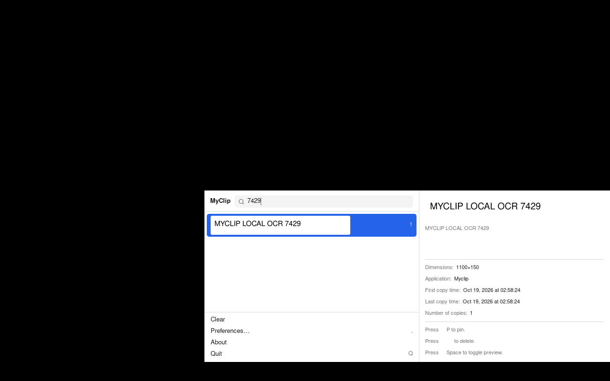

# MyClip

[](https://github.com/L92-Labs/myclip/actions/workflows/ci.yml)
[](LICENSE)

A clipboard history for the menu bar that never leaves your computer — macOS
and Linux.
No account, no cloud, no network, no telemetry. Open source (MIT).

MyClip follows the design of [Maccy](https://maccy.app) 2.7.1;
[PARITY.md](PARITY.md) lists what matches, the deviations, and MyClip's
additions. It is written in Go with
[MyGo](https://mygo.egoist.dev), using native UI drawn on the GPU. It needs
no cgo and no Xcode project. Single-architecture executables are about
12–14 MB; the universal macOS app contains both architectures.

> **Status:** early preview. macOS and Linux (X11; Wayland through XWayland).
> Linux desktop behavior is tested under Xvfb/Openbox. Real Mac permission,
> paste, OCR and sound checks, plus native Wayland desktop checks, still need
> hands-on validation. Windows is not supported.

## Download and install

Get installers and `SHA256SUMS` from [GitHub Releases](https://github.com/L92-Labs/myclip/releases).
Each tagged release builds from source in GitHub Actions; ordinary CI runs
also retain downloadable build artifacts for 14 days.

| System | Download | Install |
|---|---|---|
| macOS, Apple Silicon or Intel | `myclip-VERSION-macos-universal.dmg` (or `.zip`) | Drag MyClip to Applications |
| Linux x86-64 | `myclip-VERSION-linux-amd64.deb` or `.tar.gz` | Debian/Ubuntu: `sudo apt install ./myclip-VERSION-linux-amd64.deb` |
| Linux ARM64 | `myclip-VERSION-linux-arm64.deb` or `.tar.gz` | Same procedure, using the ARM64 file |

For a portable Linux installation, extract the archive, then run `./install.sh`
from its extracted directory. The installer adds a desktop entry and a
`myclip` command. GTK 3 and the dependencies listed below must be installed;
the Debian package declares its dependencies, including MyGo's WebKitGTK
package requirement.

macOS preview builds are **ad-hoc signed, not Developer ID signed or notarized**.
Gatekeeper may block first launch; use System Settings › Privacy & Security ›
Open Anyway after checking the download. Do not disable Gatekeeper globally.
Pasting needs Accessibility permission; copying and search work without it.
Checksums detect changed downloads; GitHub build provenance is available
through `gh attestation verify <download> --repo L92-Labs/myclip`.

Check downloads from the release directory:

```sh
shasum -a 256 -c SHA256SUMS  # macOS; on Linux use sha256sum -c SHA256SUMS
```

`SHA256SUMS` lists every installer; download all files to check the entire
manifest, or compare the hash of just the installer you downloaded.



The screenshot uses synthetic clipboard content on an X11 virtual desktop.

## What it does

- **History.** Everything you copy (text, rich text, images, files),
  newest first. Pin the clips you reuse; pins get a ⌘-letter of their own.
- **Search.** Exact, fuzzy (`gcm` finds `git commit`), regular expressions,
  or mixed, with the matches highlighted.
- **Paste for you.** Pick a clip and MyClip types ⌘V into the app you were
  in, with or without formatting. The keyboard layout is respected
  (QWERTY, AZERTY, Dvorak).
- **Find screenshots by their words.** Text in copied images is read on
  your computer (Vision on macOS, tesseract on Linux) and searched.
- **Paste stack.** ⇧↑/⇧↓ or ⇧-click several clips, then Enter: they paste
  as one, in order.
- **Hold to cycle (macOS).** Keep ⇧⌘ held after ⇧⌘C, press C again to move
  down, let go to paste or copy.
- **A sound on copy,** if you want one.
- **Preview.** The text (its first 10,000 characters), the image and its
  size, the source app, and how many times and when you copied it.
- **Your rules.** Ignore apps, pasteboard types or text patterns, pause
  capture, or skip just the next copy.
- **Languages.** English, French, Spanish.

## Privacy and security

- **Nothing goes online.** Packaged builds (`scripts/build-mac.sh` and
  `scripts/build-linux.sh`) open
  no network connection: SQLite is bundled in it. Development runs
  (`scripts/dev-mac.sh`, `go test`) may download MyGo's SQLite library once,
  checked against its SHA-256.
- **Password managers are skipped.** Copies marked concealed or transient
  (1Password, KeePassXC and others following the nspasteboard.org convention) are recognised from their types
  *before* any content is read, so the secret never enters memory or the
  database.
- **Files only you can read.** History lives in
  `~/Library/Application Support/com.l92labs.myclip/` (folder 0700, files
  0600). On Linux it lives in
  `${XDG_CONFIG_HOME:-~/.config}/com.l92labs.myclip/`. SQLite overwrites deleted
  content with `secure_delete`; this does not erase filesystem snapshots,
  backups, or copies already held by other applications. History is local
  plaintext, not encrypted; another process running as your user can read it.
- **Size caps.** Clips over 32 MB are skipped and counted. The history keeps
  200 items by default; pins don't count toward that.
- **Fail closed.** If MyClip cannot read its settings, it stops capturing
  rather than fall back to defaults that could miss your ignore rules. The
  menu icon offers Reset Settings.
- **Few permissions.** Copying needs none. Pasting for you needs
  Accessibility, used only to type ⌘V. *Notify on each new copy*, off by
  default, asks for the Notifications permission when you turn it on.

## Keyboard

| In the popup (default keys) | |
|---|---|
| ⇧⌘C | open MyClip from any app (configurable) |
| ↑ ↓ · ⌃N ⌃P · ⌘↑ ⌘↓ | move · first · last |
| ↵ | copy |
| ⌥↵ · ⌥⇧↵ | paste · paste without formatting |
| ⌘1 … ⌘9 | the nth clip; ⌘-letter for a pin |
| ⌥P · ⌥⌫ · ⌃Space | pin · delete · preview (configurable) |
| ⌥⌘⌫ · ⇧⌥⌘⌫ | clear history · clear including pins |
| Esc · ⌘, · ⌘Q | close · settings · quit |

With *Paste automatically* or *Paste without formatting* on, the ↵ ⌥↵ ⌥⇧↵
actions swap as Maccy's do; Settings › General shows the current map.

Click the menu icon with ⌥ to pause or resume capture. While capture is on,
click with ⌥⇧ to ignore only the next copy (while paused, ⌥⇧-click resumes,
as in Maccy).

## Build

On a Mac with the Xcode Command Line Tools (`xcode-select --install`),
Python 3 and Go matching `go.mod`:

```sh
scripts/build-mac.sh --dmg --open       # test, build build/darwin-<arch>/myclip.app + .dmg, launch
scripts/build-mac.sh --universal --dmg  # arm64 + x86_64
scripts/dev-mac.sh                      # live-reload development run
scripts/test.sh                         # go vet + go test (macOS or Linux)
python3 scripts/licenses.py --check      # verify bundled third-party notices
```

The first launch of an ad-hoc signed build needs right-click → Open.
`MYCLIP_SHOW=popup` (or `popup-preview`, `prefs:<tab>`) opens a window at
launch, for screenshots.

On Linux (GTK 3):

```sh
scripts/build-linux.sh    # test, build build/linux-<arch>/: binary, .deb, .tar.gz + install.sh
scripts/linux-smoke.sh    # end-to-end on a virtual display (Xvfb + openbox)
```

| Linux needs | for |
|---|---|
| GTK 3, OpenGL/EGL, Fontconfig/FreeType | native window, rendering and fonts |
| `libayatana-appindicator3` | the menu icon (without it, open MyClip with its shortcut) |
| `xdotool` (X11) or `wtype` / `ydotool` (Wayland) | pasting for you; copying works without |
| `tesseract-ocr` and its language data | local image OCR; text history works without it |
| `xprop` | telling apps apart for Ignore › Applications (by WM_CLASS, typed in Settings); in *ignore all except listed* mode, an app it cannot name is ignored |

Under Wayland, MyClip runs through XWayland, whose clipboard the compositor
keeps in sync, because native Wayland apps cannot read the clipboard while
unfocused. The compositor keeps global keys for itself there, so bind
⇧+Super+C to `myclip --toggle` in your desktop's keyboard settings (running
`myclip` again does the same). The menu icon's menu has Open MyClip too. Password managers following KDE's convention (KeePassXC…) mark
secrets with `x-kde-passwordManagerHint`; MyClip skips them unread. ⌘ in
the key map is Ctrl on Linux, and ⇧⌘C is ⇧+Super+C.

## Layout

| Path | |
|---|---|
| `internal/capture` | the capture rules: ignore chain, change-count sandwich, size cap |
| `internal/history` · `internal/store` | items, merging, sorting · SQLite with the security recipe |
| `internal/engine` | capture → merge → store, copy-back, pins, clearing |
| `internal/native` | the OS: AppKit, CoreGraphics and Carbon on macOS; GTK and X11 on Linux (purego, no cgo) |
| `internal/popup` · `internal/prefs` | the popup and the settings window |
| `internal/search` · `internal/shortcut` · `internal/settings` | search modes · accelerators · preferences |
| `locales/` | EN / FR / ES catalogs (`go tool mygo generate`) |
| `PLAN.md` · `PARITY.md` | milestones and gates · the Maccy feature inventory and deviations |

## Credits

MyClip's design follows [Maccy](https://github.com/p0deje/Maccy) by Alex
Rodionov and contributors (MIT); see [NOTICE.md](NOTICE.md). Icons from
[Lucide](https://lucide.dev) (ISC).

[MIT](LICENSE) © L92 Labs

## Contributing and releases

See [CONTRIBUTING.md](CONTRIBUTING.md) for local setup and checks,
[SECURITY.md](SECURITY.md) for private vulnerability reports, and
[docs/RELEASING.md](docs/RELEASING.md) for the release process.
[THIRD_PARTY_NOTICES.txt](THIRD_PARTY_NOTICES.txt) contains dependency licenses.
Historical design notes in PLAN.md, PARITY.md and LEDGER.md include planned
features; this README describes the current app.
