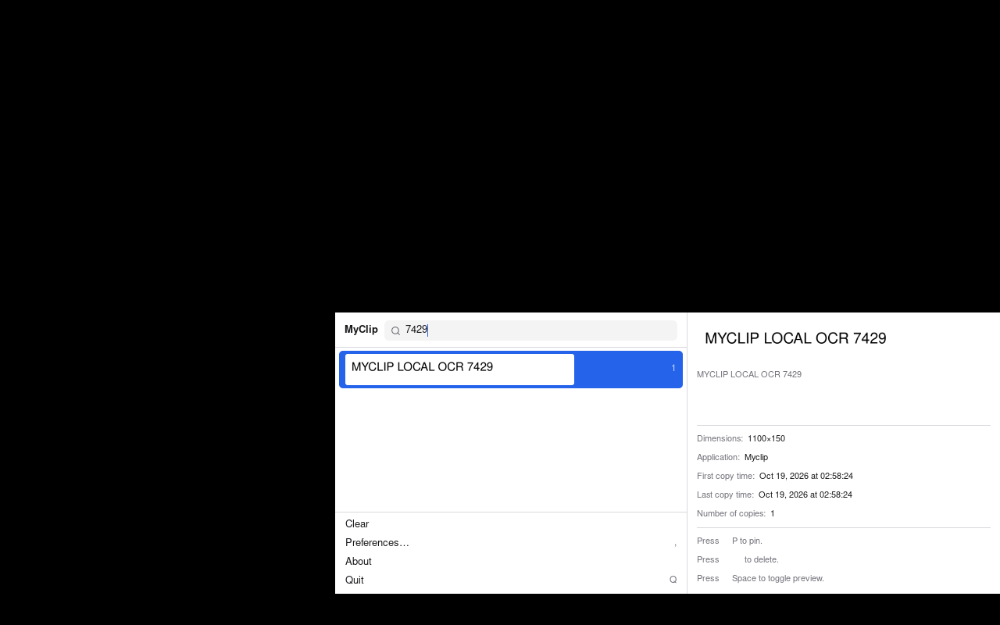

# MyClip

[](https://github.com/L92-Labs/myclip/actions/workflows/ci.yml)
[](LICENSE)

A local-only clipboard history for the menu bar on macOS and Linux, with a
Windows preview. Copy something, then find it again in MyClip.
No account, cloud, or telemetry. The macOS and Linux packages run offline.
Windows builds may need a [one-time SQLite download](#privacy-and-security).
Open source (MIT).
<!-- source: main.go:77, scripts/build-mac.sh:77, scripts/build-linux.sh:39, .github/workflows/ci.yml:120, MyGo v0.6.2 cmd/mygo/build.go:200,275,330 and plugins/sqlite/library.go:83, LICENSE:1 -->

## Quick start

On an x86-64 or ARM64 Linux desktop with X11 or XWayland, run this from the
root of a fresh clone. You need Bash, Go matching [go.mod](go.mod), Python 3,
GTK 3, OpenGL/EGL, Fontconfig and FreeType.
<!-- source: CONTRIBUTING.md:8, go.mod:3, scripts/build-linux.sh:1, scripts/build-linux.sh:30, main.go:50 -->

```sh
arch=$(go env GOHOSTARCH) &&
  GOARCH="$arch" scripts/build-linux.sh \
    --arch "$arch" &&
  (cd "build/linux-$arch" &&
    ./myclip --toggle)
```
<!-- source: scripts/build-linux.sh:2, scripts/build-linux.sh:24, scripts/build-linux.sh:37, mygo.json:7, .github/workflows/ci.yml:138, main.go:91, main.go:227 -->

For macOS and Linux downloads or Windows source builds, see
[Download and install](#download-and-install).
<!-- source: GitHub release v0.1.0 assets, .github/workflows/ci.yml:120 -->

## Download and install

[Release v0.1.0](https://github.com/L92-Labs/myclip/releases/tag/v0.1.0)
publishes the macOS and Linux packages below with `SHA256SUMS`.
<!-- source: GitHub release v0.1.0 assets -->

| System | Download | Install |
|---|---|---|
| macOS, Apple Silicon or Intel | `myclip-0.1.0-macos-universal.dmg` (or `.zip`) | Open the DMG or extract the ZIP, then drag MyClip to Applications |
| Linux x86-64 | `myclip-0.1.0-linux-amd64.deb` or `.tar.gz` | Debian/Ubuntu: `sudo apt install "./myclip-0.1.0-linux-amd64.deb"` |
| Linux ARM64 | `myclip-0.1.0-linux-arm64.deb` or `.tar.gz` | Debian/Ubuntu: `sudo apt install "./myclip-0.1.0-linux-arm64.deb"` |

On Linux, install the runtime libraries listed under [Build](#build). The
Debian package declares its dependencies, including MyGo's WebKitGTK package
requirement. For the portable archive, unpack it into a separate directory
and run the bundled executable from there. This example starts in the Linux
x86-64 download directory and uses a POSIX shell with `tar`.
<!-- source: v0.1.0 Linux tar.gz contents, scripts/release.py:24, MyGo v0.6.2 cmd/mygo/deb.go:36 -->

```sh
portable_dir=$(mktemp -d) &&
  tar -xzf "myclip-0.1.0-linux-amd64.tar.gz" -C "$portable_dir" &&
  (cd "$portable_dir" && ./myclip --toggle)
```

For a per-user installation, the Linux source build generates `install.sh`
separately from the archive. After building for Linux x86-64 with the
prerequisites under [Build](#build), run the installer from the clone root as
your regular user. The example below builds first, then passes the archive
path explicitly. The installer adds a desktop entry and a `myclip` command
and checks for WebKitGTK.
<!-- source: scripts/build-linux.sh:2, mygo.json:7, MyGo v0.6.2 cmd/mygo/installscript.go:124,166,203,215,249 -->

```sh
scripts/build-linux.sh --arch amd64 &&
  sh "build/linux-amd64/install.sh" "build/linux-amd64/myclip-0.1.0-linux-amd64.tar.gz"
```

Release v0.1.0 has no Windows downloads. On Windows x86-64, install Go
matching [go.mod](go.mod) and build from the clone root in PowerShell.
[CI](https://github.com/L92-Labs/myclip/actions/workflows/ci.yml) also builds a
Windows installer and portable ZIP. Ordinary CI runs retain downloadable
build artifacts for 14 days.
<!-- source: GitHub release v0.1.0 assets, .github/workflows/ci.yml:96,120,147, docs/RELEASING.md:3 -->

```powershell
go build -trimpath -ldflags "-s -w" -o myclip.exe .
```

On first launch, this executable downloads MyGo's SQLite DLL if it cannot
find a bundled, adjacent, configured, or valid cached copy. The CI installer
and ZIP use the same executable and also omit the DLL.
<!-- source: main.go:145, internal/store/store.go:57, .github/workflows/ci.yml:115, scripts/windows.iss:24, MyGo v0.6.2 plugins/sqlite/library.go:59 and plugins/sqlite/mygo-plugin.json:27 -->

macOS preview builds are **ad-hoc signed, not Developer ID signed or notarized**.
Gatekeeper may block first launch; use System Settings › Privacy & Security ›
Open Anyway after checking the download. Do not disable Gatekeeper globally.
On macOS, pasting into another app needs Accessibility permission. Copying
and search work without it.
<!-- source: app_popup.go:131,152, internal/native/input_darwin.go:123, internal/popup/popup.go:202, https://support.apple.com/en-us/102445 -->
Checksums detect changed downloads. To verify GitHub build provenance,
install and authenticate the GitHub CLI, then run this example from the
download directory.
<!-- source: v0.1.0 .github/workflows/ci.yml:161, gh attestation verify --help -->

```sh
gh attestation verify "myclip-0.1.0-linux-amd64.tar.gz" --repo L92-Labs/myclip
```

Check downloads from the release directory using the checksum tool for your OS.

```sh
case "$(uname -s)" in
  Darwin) shasum -a 256 -c SHA256SUMS ;;
  Linux)  sha256sum -c SHA256SUMS ;;
esac
```
<!-- source: v0.1.0 SHA256SUMS release asset -->

`SHA256SUMS` lists every installer; download all files to check the entire
manifest, or compare the hash of just the installer you downloaded.



The screenshot uses synthetic clipboard content on an X11 virtual desktop.

## What it does

MyClip follows the design of [Maccy](https://maccy.app) 2.7.1;
[PARITY.md](PARITY.md) lists what matches, the deviations, and MyClip's
additions. It is written in Go with
[MyGo](https://mygo.egoist.dev), using native UI drawn on the GPU. It needs
no cgo and no Xcode project. The universal macOS executable supports
both Apple Silicon and Intel.
<!-- source: scripts/build-mac.sh:6, scripts/release.py:49 -->

> **Status:** early preview. macOS and Linux (X11; Wayland through XWayland)
> and Windows. Linux desktop behavior is tested under Xvfb/Openbox. Real Mac
> permission, paste, OCR and sound checks, plus native Wayland desktop
> checks, still need hands-on validation. Windows CI builds, tests, OCR and
> the installer are exercised automatically, but clipboard, paste and tray
> behavior still need hands-on validation on real hardware.

See the [Awesome MyGo listing](https://awesomemygo.dev/apps/myclip).
<!-- source: README.md:5 at 64d8314 -->

- **History.** Keeps supported clips (text, rich text, images, and file
  references) subject to your capture rules and history limits. By default,
  pins appear first and clips are sorted by most recent copy. Each pin gets
  its own ⌘-letter shortcut.
  <!-- source: internal/pasteboard/types.go:70, internal/capture/capturer.go:94, internal/settings/settings.go:176, internal/history/display.go:24, internal/popup/popup.go:231 -->
- **Search.** Exact, fuzzy (`gcm` finds `git commit`), regular expressions,
  or mixed, with matches highlighted in visible titles by default.
  <!-- source: internal/search/search.go:42, internal/popup/popup.go:221,602, internal/settings/settings.go:185 -->
- **Paste for you.** Choose a paste action to send ⌘V on macOS or Ctrl+V
  on Linux and Windows, with or without formatting. On macOS, MyClip looks
  up the V key in the current keyboard layout.
  <!-- source: app_popup.go:131,152, internal/engine/ops.go:453, internal/native/input_darwin.go:147, internal/native/input_linux.go:71, internal/native/input_windows.go:112 -->
- **Find screenshots by their words.** MyClip uses local OCR on eligible
  copied images and includes recognized text in search. It uses Vision on
  macOS, tesseract on Linux, and the Windows OCR engine on Windows.
  <!-- source: app_ocr.go:82, internal/popup/popup.go:202, internal/native/ocr_darwin.go:41, internal/native/ocr_linux.go:17, internal/native/ocr_windows.go:18 -->
- **Paste stack.** Select a range with ⇧↑/⇧↓ or ⇧-click. By default, Enter
  copies the stack and ⌥Enter pastes it. The stack combines text or a set
  of file references in the order shown.
  <!-- source: internal/popup/popup.go:33,276,304,356, app_popup.go:140, internal/engine/ops.go:396 -->
- **Hold to cycle (macOS).** Keep ⇧⌘ held after ⇧⌘C, press C again to move
  down, let go to paste or copy.
- **A sound on copy,** if you want one.
- **Preview.** The first 10,000 characters of text, the image and its
  dimensions when it can be displayed, the source app when known, and how
  many times and when you copied the clip.
  <!-- source: internal/popup/popup.go:828,873 -->
- **Your rules.** Ignore apps, pasteboard types or text patterns, pause
  capture, or skip just the next copy.
- **Languages.** English, French, Spanish.

## Privacy and security

- **Offline runtime.** The macOS and Linux packages bundle SQLite and
  MyClip runs without network access. Windows source and CI builds download
  MyGo's SQLite DLL on first launch if no usable copy is already available.
  MyGo verifies the download against its SHA-256. For development,
  `scripts/dev-mac.sh` can fetch SQLite when preparing the app, and
  `go test` can fetch it when a test opens the database.
  <!-- source: scripts/build-mac.sh:77, scripts/build-linux.sh:39, scripts/dev-mac.sh:11, main.go:77, .github/workflows/ci.yml:120, MyGo v0.6.2 cmd/mygo/build.go:200,275,330, cmd/mygo/dev.go:558 and plugins/sqlite/library.go:59 -->
- **Marked secrets are skipped.** MyClip checks clipboard types for
  concealed or transient markers before reading clip contents. It skips
  copies carrying those markers without storing them.
  <!-- source: internal/pasteboard/types.go:53, internal/capture/ignore.go:21, internal/capture/capturer.go:118 -->
- **Local history files.** On macOS and Linux the data directory is mode
  0700 and the history database is mode 0600. History lives in
  `~/Library/Application Support/com.l92labs.myclip/` on macOS and
  `${XDG_CONFIG_HOME:-~/.config}/com.l92labs.myclip/` on Linux. SQLite overwrites
  deleted database content with `secure_delete`. Filesystem snapshots, backups,
  and copies held by other apps may still contain the data. History is
  plaintext and another process running as your user can read it.
  <!-- source: main.go:35,82, internal/instance/instance.go:15, internal/store/perm_unix.go:13, internal/store/store.go:36,104, https://sqlite.org/pragma.html#pragma_secure_delete -->
- **Size caps.** Captured clips over 32 MiB are skipped and counted. The
  default history count limit is 200 unpinned clips.
  <!-- source: internal/capture/capturer.go:18,173, internal/engine/engine.go:120, internal/settings/settings.go:177, internal/history/history.go:168 -->
- **Fail closed.** If MyClip cannot read its settings, it stops capturing
  rather than fall back to defaults that could miss your ignore rules. The
  menu icon offers Reset Settings.
- **Few permissions.** On macOS, copying works without Accessibility
  permission. MyClip uses it to send ⌘V when you paste. *Notify on each new
  copy* is off by default. In the macOS app bundle, enabling it can lead
  to a permission prompt when MyClip first tries to show a copy
  notification. macOS remembers your response.
  <!-- source: app_popup.go:131,152, main.go:322, internal/settings/settings.go:168, MyGo v0.6.2 internal/darwin/notify.go:69,105, https://developer.apple.com/documentation/usernotifications/unusernotificationcenter/requestauthorization(options:completionhandler:) -->

## Keyboard

| In the popup (default keys) | |
|---|---|
| ⇧⌘C | toggle MyClip from any app when the global shortcut is available (configurable) <!-- source: app_popup.go:22, cycle.go:72 --> |
| ↑ ↓ or ⌃N ⌃P · ⌘↑ · ⌘↓ | move · first · last <!-- source: internal/popup/popup.go:381 --> |
| ↵ | copy |
| ⌥↵ · ⌥⇧↵ | paste · paste without formatting |
| ⌘1 … ⌘9 | select by position among the visible unpinned clips. Use ⌘-letter for a pin. <!-- source: internal/popup/popup.go:221,362 --> |
| ⌥P · ⌥⌫ · ⌃Space | pin · delete · preview (configurable) |
| ⌥⌘⌫ · ⇧⌥⌘⌫ | clear history · clear including pins |
| Esc · ⌘, · ⌘Q | close · settings · quit |

*Paste automatically* and *Paste without formatting* change the selection
actions. Settings › General shows the current selection modifiers.
<!-- source: internal/popup/popup.go:30, internal/prefs/prefs.go:268,293 -->

On macOS, Option-click the menu icon to pause or resume capture. On Windows,
use Alt-click. Add Shift to ignore the next copy while capture is on.
If capture is paused, either modifier click resumes it.
<!-- source: tray.go:54,65, internal/native/input_darwin.go:115, internal/native/input_windows.go:56, MyGo v0.6.2 internal/windows/tray.go:299 -->

On Linux, use the AppIndicator menu for **Pause Capture** and **Ignore Next
Copy**. On macOS and Windows those same items are in the icon's right-click
menu. The menu on all three platforms also offers Open MyClip, Preferences,
About, and Quit. It shows the clip count and any skipped-clip or save
status. If unreadable settings stop capture, the menu offers Reset Settings.
<!-- source: tray.go:20,44,130, MyGo v0.6.2 internal/linux/menu.go:455 -->

## Configuration

| Setting | Default | Effect |
|---|---|---|
| Popup shortcut | ⇧⌘C on macOS, ⇧+Super+C on Linux | Opens clipboard history. <!-- source: internal/settings/settings.go:76, scripts/linux-smoke.sh:67 --> |
| Search mode | Exact | Also supports fuzzy, regex and mixed search. <!-- source: internal/settings/settings.go:64, internal/settings/settings.go:174 --> |
| History size | 200 items | Sets how many unpinned clips are kept. <!-- source: internal/settings/settings.go:177, internal/history/history.go:168 --> |
| Notify on each new copy | Off | Shows a notification for a newly added clip on supported systems. Copies merged into an existing clip do not trigger it. <!-- source: internal/settings/settings.go:118,168, internal/engine/engine.go:172, main.go:169,322 --> |
| `MYCLIP_SHOW` | Unset | Set before launch to `popup`, `popup-preview` or `prefs:<tab>` to open that window for screenshots. <!-- source: main.go:221, main.go:233 --> |

## Build

On a Mac with the Xcode Command Line Tools (`xcode-select --install`),
Python 3 and Go matching `go.mod`:

```sh
scripts/build-mac.sh --dmg --open       # test, build the app and DMG, launch
scripts/build-mac.sh --universal --dmg  # arm64 + x86_64
```
<!-- source: scripts/build-mac.sh:2 -->

If Gatekeeper blocks the first launch, use System Settings › Privacy &
Security › Open Anyway after checking the build.
<!-- source: scripts/build-mac.sh:92, https://support.apple.com/en-us/102445 -->

For a live-reload development session, run the following in the foreground.
Quit the session with Ctrl+C before running the checks below.
<!-- source: scripts/dev-mac.sh:2,11 -->

```sh
scripts/dev-mac.sh
```

```sh
scripts/test.sh                     # go vet + go test (macOS or Linux)
python3 scripts/licenses.py --check  # verify bundled third-party notices
```
<!-- source: CONTRIBUTING.md:15 -->

On Linux, use Bash, Go matching `go.mod`, Python 3, GTK 3, OpenGL/EGL,
Fontconfig and FreeType. For the full desktop smoke test, install Xvfb,
Openbox, libX11, libXtst (`libXtst.so.6`) and xdotool. Install scrot if
capturing screenshots. See [Contributing](CONTRIBUTING.md#setup).
<!-- source: CONTRIBUTING.md:8, scripts/build-linux.sh:30, scripts/linux-smoke.sh:10,25,35,67, _tools/xkeys.py:3, .github/workflows/ci.yml:132 -->

```sh
scripts/build-linux.sh    # test and build the binary, packages and install.sh
scripts/linux-smoke.sh    # end-to-end on a virtual display
```

| Linux needs | for |
|---|---|
| GTK 3, OpenGL/EGL, Fontconfig/FreeType | native window, rendering and fonts |
| `libayatana-appindicator3` | the menu icon (without it, open MyClip with its shortcut) |
| `xdotool` / `ydotool` (X11) or `wtype` / `ydotool` (Wayland) | pasting for you. Copying works without these tools. <!-- source: internal/native/input_linux.go:38, app_popup.go:131 --> |
| `tesseract-ocr` and its language data | local image OCR; text history works without it |
| `xprop` | telling apps apart for Ignore › Applications (by WM_CLASS, typed in Settings); in *ignore all except listed* mode, an app it cannot name is ignored |

In a Wayland session with XWayland available, MyClip defaults to X11 unless
you set `GDK_BACKEND`. This uses the compositor's XWayland clipboard bridge
for background capture. For a global shortcut on Wayland, bind ⇧+Super+C
to `myclip --toggle` in your desktop's keyboard settings. Running `myclip`
again also toggles the running app, and the tray menu offers Open MyClip.
<!-- source: internal/native/input_linux.go:26, main.go:62, tray.go:143, MyGo v0.6.2 internal/linux/hotkey.go:66 -->

MyClip skips copies marked with KDE's `x-kde-passwordManagerHint` before
reading their contents. In the popup key map, ⌘ is Ctrl on Linux and
Windows. The Linux global shortcut ⇧⌘C uses ⇧+Super+C.
<!-- source: internal/native/pasteboard_linux.go:32,57,134, internal/capture/capturer.go:133, internal/settings/settings.go:76, scripts/linux-smoke.sh:67, MyGo v0.6.2 ui/keys.go:112 -->

## Layout

| Path | |
|---|---|
| `internal/capture` | the capture rules: ignore chain, change-count sandwich, size cap |
| `internal/history` · `internal/store` | items, merging, sorting · SQLite with the security recipe |
| `internal/engine` | capture → merge → store, copy-back, pins, clearing |
| `internal/native` | the OS: AppKit, CoreGraphics and Carbon on macOS; GTK and X11 on Linux (purego, no cgo) |
| `internal/popup` · `internal/prefs` | the popup and the settings window |
| `internal/search` · `internal/shortcut` · `internal/settings` | search modes · accelerators · preferences |
| `locales/` | EN / FR / ES catalogs (`go tool mygo generate`) |
| `PLAN.md` · `PARITY.md` | milestones and gates · the Maccy feature inventory and deviations |

## Credits

MyClip's design follows [Maccy](https://github.com/p0deje/Maccy) by Alex
Rodionov and contributors (MIT); see [NOTICE.md](NOTICE.md). Icons from
[Lucide](https://lucide.dev) (ISC).

[MIT](LICENSE) © L92 Labs

## Contributing and releases

See [CONTRIBUTING.md](CONTRIBUTING.md) for local setup and checks,
[SECURITY.md](SECURITY.md) for private vulnerability reports, and
[docs/RELEASING.md](docs/RELEASING.md) for the release process.
[THIRD_PARTY_NOTICES.txt](THIRD_PARTY_NOTICES.txt) contains dependency licenses.
Historical design notes in PLAN.md, PARITY.md and LEDGER.md include planned
features; this README describes the current app.
